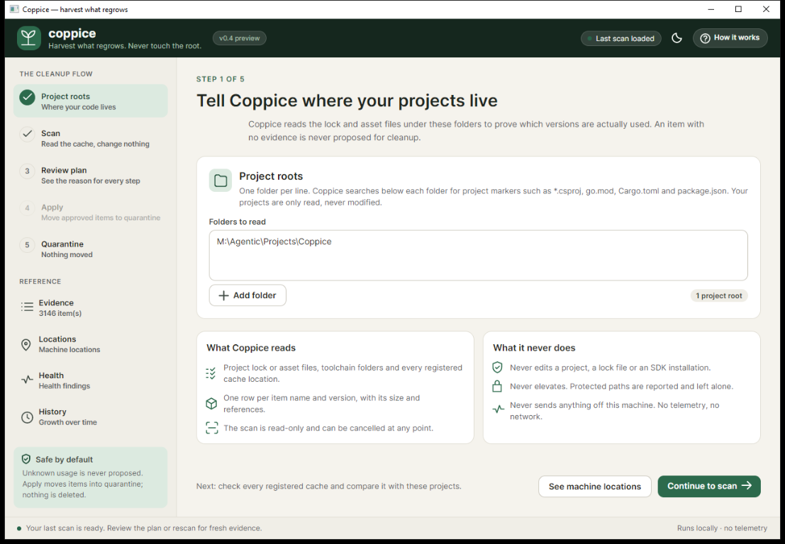
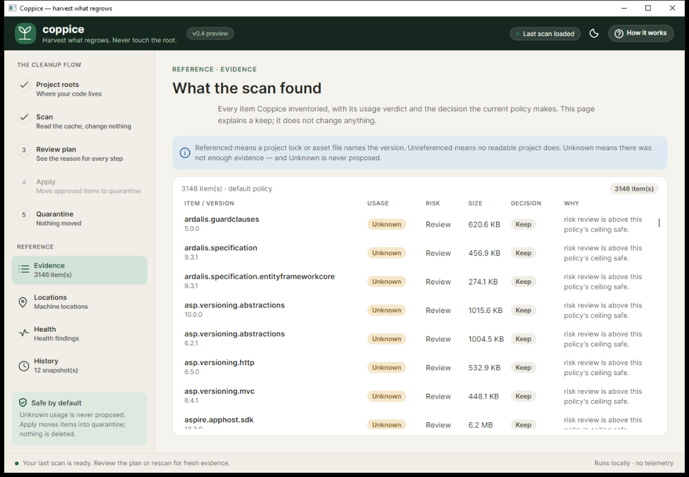
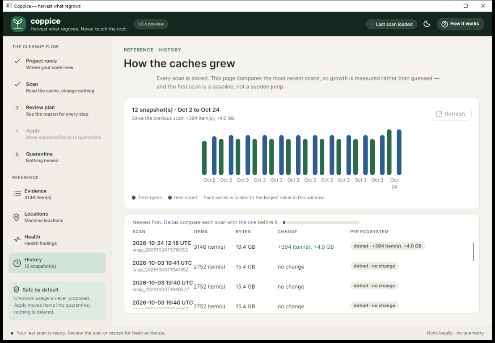

# coppice

/ˈkɒp.ɪs/ · *KOP-is* — verb: to cut a tree back to its stump so it regrows vigorously from the living root system.

> Harvest what regrows. Never touch the root.

A native, plugin-based toolchain and cache cleaner for polyglot developers.

| | |
|---|---|
| **License** | Apache-2.0 |
| **Status** | v0.4.0-rc.1 — release candidate (human gates open; 0.3.0 was never tagged — see ADR-017) |
| **Platforms** | Windows, Linux, macOS (x64/arm64) |
| **Runtime** | .NET 10. No container runtime, daemon, service or middleman |

## What it does

Developer machines accumulate toolchains and caches: dozens of SDK versions, thousands of cached
package versions, build caches, global tools. Removing them is fragmented and risky, so nobody does it.

coppice resolves where those caches live, proves what is actually in use, proposes a plan with a
reason for every step, and — after you confirm it — moves approved items into a quarantine you can
restore from. It never deletes during `apply`, and every mutation is recorded in a hash-chained audit
ledger.

The pipeline is:

```
doctor → scan --projects → plan → apply → quarantine list
```

## Install

Coppice runs natively. There is no Docker image, daemon, service, sidecar or helper process in the
install or the command path.

**Framework-dependent single file** (needs the .NET 10 runtime; ~2 MB):

```bash
bash scripts/publish.sh win-x64        # or linux-x64, linux-arm64, osx-x64, osx-arm64, win-arm64
```

**Self-contained single file** (needs no .NET installed; ~37 MB):

```bash
SELF_CONTAINED=1 bash scripts/publish.sh win-x64
```

**dotnet tool** (pack from a checkout, or use a feed that carries it):

```bash
dotnet pack src/Coppice.Cli/Coppice.Cli.csproj -c Release -o artifacts/packages
dotnet tool install --global --add-source ./artifacts/packages coppice --version 0.4.0-rc.1
```

**Release downloads.** A tag builds all six RIDs through
[`.github/workflows/release.yml`](./.github/workflows/release.yml): framework-dependent and
self-contained CLI archives, a self-contained GUI archive, the `dotnet tool` package, plus
`SHA256SUMS.txt` and `SIZES.txt`. The workflow refuses to publish unless the tag matches `<Version>`
and the tagged commit already has a green six-cell `build.yml` run; it also smoke-tests the linux-x64
self-contained archive on a scratch cache with no .NET on `PATH` before publishing. No `v0.4.0` tag
exists yet; `0.4.0-rc.1` is the candidate, so build from a checkout with the commands above.

The publish directory contains the binary, `README.md`, `CHANGELOG.md`, `LICENSE`, `NOTICE` and
`docs/`. See [docs/quickstart.md](./docs/quickstart.md) for every install path and the PowerShell
equivalent of the publish command.

## Quickstart

```bash
coppice doctor                          # read-only: where are the registered cache locations?
coppice scan --projects ~/src           # inventory the registered ecosystems, prove what is referenced
coppice plan                            # propose steps from the newest snapshot
coppice apply                           # show the plan, ask, then move to quarantine
coppice quarantine list                 # see what moved; restore <id> puts it back
```

`--projects` is repeatable and is not auto-discovered from the current directory. Without a project
root, every cached version stays `Unknown`, and Coppice will not propose it. That is the safety rule,
not a bug.

For scripted use, `--ci` produces machine-readable output and never prompts. `apply --ci` still
requires both `--plan` and `--yes`; consent is not a flag you can accidentally inherit.

## Commands

| Command | What it does |
|---|---|
| `coppice doctor` | Resolve registered locations (NuGet, Go, Rust, Node); report what validated and what did not. Read-only. |
| `coppice roots` | The detailed candidate table behind `doctor`. Read-only. |
| `coppice scan [--projects <path>]...` | Inventory the registered ecosystems and store a snapshot. Read-only toward the caches. |
| `coppice plan [--policy ...] [--keep-latest N] [--out file]` | Build and store a plan. Touches no cache. |
| `coppice apply [--plan file] [--yes] [--strict] [--resume]` | Move approved steps to quarantine. |
| `coppice quarantine list\|restore\|prune` | Inspect, undo, or permanently discard quarantined items. |
| `coppice audit show\|verify` | Read and verify the hash-chained mutation ledger. |
| `coppice completions <shell>` | Print a PowerShell/bash/zsh/fish completion script. Read-only. |
| `coppice history [--limit N]` | Compare recent snapshots and show per-ecosystem growth. Read-only. |
| `coppice tui` | Seven-screen terminal UI sharing the same plan, gateway and journal. |

Full flags, confirmation rules, state locations and exit codes:
[docs/commands.md](./docs/commands.md).

Exit codes: `0` success · `1` runtime error · `2` usage error · `3` safety abort · `4` partial or
cancelled apply.

## GUI (v0.4 release candidate)

The Avalonia desktop shell runs the same services as the CLI:

```bash
dotnet run --project src/Coppice.Gui
# or publish the self-contained artifact (~47.7 MB):
bash scripts/publish-gui.sh win-x64
```

Screenshots from the 0.4.0-rc.1 shell on Windows:







The T-050 shell has Setup/Scan/Dashboard, Items, Plan review, Apply, Quarantine, Roots, Problems and
History, with the retention picker's **Keep newest only** policy (the same as
`coppice plan --keep-latest 1`). Preferences go through `IShellPreferencesStore`; the headless tests
cover the full scan → plan → apply → restore flow and a measured scan cancel. T-040 adds the pin
editor and per-candidate provenance: the Roots screen shows via/detail, owner, size, ambiguity and
the never-elevate guidance, and a pin is validated through the same denylist/fingerprint path before
it is written. The GUI is a release candidate, not part of the CLI artifact; `scripts/publish-gui.sh`
builds it.

## Safety model

- **Dry-run by default.** `doctor`, `roots`, `scan` and `plan` do not modify a scanned cache. `apply`
  asks first; when it cannot ask, it requires `--yes` and a plan file.
- **Unknown ≠ unused.** Every item is `Referenced`, `Unreferenced`, or `Unknown`. `Unknown` is never
  proposed, because absence of evidence is not evidence of absence.
- **One gateway.** Every path move passes a single executor: entry allowlist, containment in a
  validated root, denylist floor, lock probe, optional strict mtime check, and full TOCTOU
  re-verification immediately before the rename.
- **Absolute local roots only.** Relative, drive-relative (`\Windows`) and UNC Windows paths are
  refused canonicalization, and a drive root is denied; the denylist floor covers Windows drive roots.
- **Quarantine, not deletion.** `apply` renames into `<cache-volume>/.coppice/quarantine/` on the same
  volume. Restore re-checks the content hash, containment and occupancy before moving anything back.
  Only the separately confirmed `quarantine prune` deletes permanently.
- **Signed history.** Every mutation appends one hash-chained JSONL line. `audit verify` replays it
  against the index and the filesystem.
- **No network. No telemetry. No elevation.** Coppice runs as you, offline.

The reasoning, including the escape suite and the kill-and-resume test: [docs/safety.md](./docs/safety.md)
and [SDD/06-safety-model.md](./SDD/06-safety-model.md).

## Scope in v0.4 (release candidate)

- **Ecosystems.** The .NET, Go, Rust and Node profiles are wired into `scan`/`plan`/`apply`
  (T-048). A new manifest + plugin is one registry entry; T-056 removed the last ecosystem special
  case, and T-057 adds opt-in user manifests. On a real polyglot machine the doctor reports
  dotnet/go/node and the scan inventories all three; T-059 fixed probe starvation and the Windows
  Go/npm paths.
- **Config.** T-049 reads `config.toml` for project roots, policy and exclusions; explicit flags
  still win. T-052 applies pins and quarantine retention, and T-057 adds opt-in user manifests.
- **No `clean`, `report` or `config` verbs.** The report exporters, including the self-contained HTML
  exporter, exist; the verbs are not wired. `completions` and `history` are implemented.
- **GUI.** The T-050 shell and T-040 pin editor are the release-candidate GUI. The manual
  screen-reader pass is still open.
- **Clean-machine evidence is partial.** The self-contained rc.1 artifact completes
  version → doctor → scan → plan → apply → restore → audit verify with no .NET on `PATH` and isolated
  state (2026-10-26). A true fresh-VM install → apply transcript and the dogfood reports remain human
  gates recorded in `SDD/AGENDA.md`; this is why the release is `0.4.0-rc.1`, not a tag.
- **Scan performance:** NFR-04 is met on a real fixture: 30,000 items / 31,457,280,000 bytes in
  9.965 s; the real 3,152-package / 19.4 GB cache is 15.6–17.7 s after the T-058 reference-index fix.
  A real all-ecosystem scan of 3,179 items (3,152 .NET, 26 Go, 1 npm) takes 16.6–21.0 s.

## Documentation

| Document | Contents |
|---|---|
| [docs/quickstart.md](./docs/quickstart.md) | Install, first run, non-interactive use, state locations |
| [docs/safety.md](./docs/safety.md) | Why the default is dry-run; gateway, quarantine, audit, limits |
| [docs/commands.md](./docs/commands.md) | Every verb, flag, confirmation rule and exit code |
| [docs/release-notes-v0.4.md](./docs/release-notes-v0.4.md) | The 0.4.0 release candidate and its open human gates |
| [docs/release-notes-v0.3.md](./docs/release-notes-v0.3.md) | The withdrawn 0.3.0 candidate and what it did not prove |
| [SDD/AGENDA.md](./SDD/AGENDA.md) | The live work queue, card status and human gates |
| [SDD/ORCHESTRATION.md](./SDD/ORCHESTRATION.md) | Multi-agent roles, ownership, merge protocol and gates |
| [docs/adr/ADR-017-release-truth-and-size-budget.md](./docs/adr/ADR-017-release-truth-and-size-budget.md) | Release truth and the amended NFR-11 size budget |
| [CHANGELOG.md](./CHANGELOG.md) | Change history |
| [SDD/](./SDD/) | The specification: requirements, architecture, plugin contract, safety model, roadmap, task cards |

## Build and test

Requires the .NET 10 SDK.

```bash
dotnet build
dotnet test
dotnet format --verify-no-changes
bash scripts/publish.sh win-x64
bash scripts/verify-golden.sh
```

The repository keeps the ports and kernel domain frozen under ADR-011; architecture tests enforce
that core and plugins reference only the ports and touch no `System.IO` or network type (NFR-08).

## License

Apache-2.0 — see [LICENSE](./LICENSE) and [NOTICE](./NOTICE).
